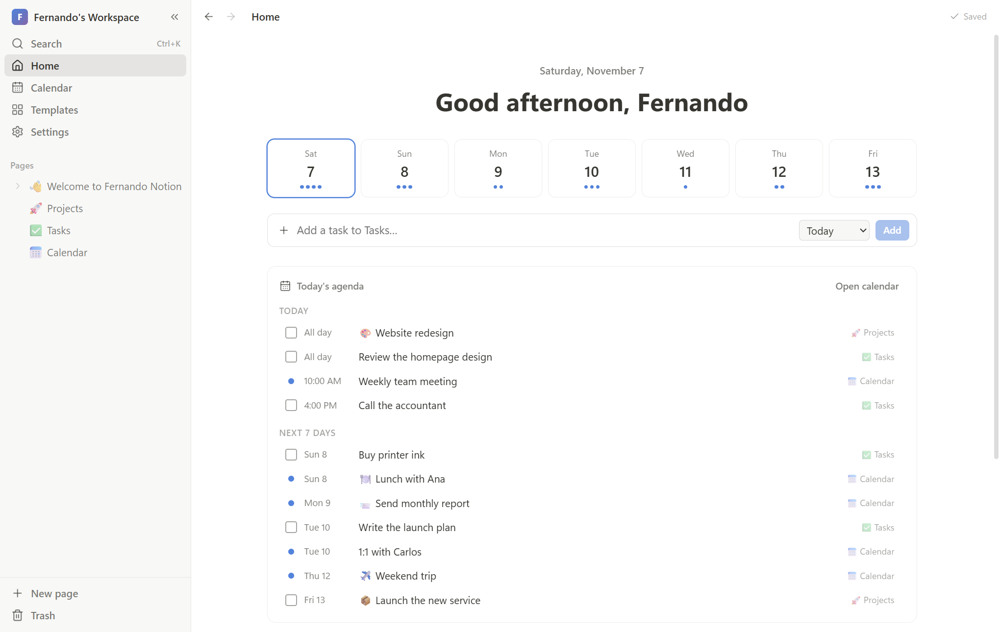
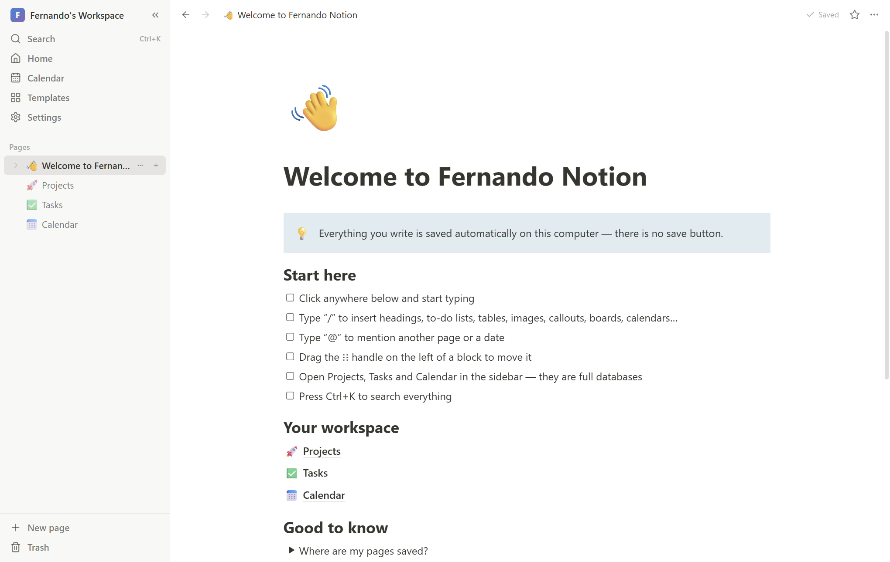
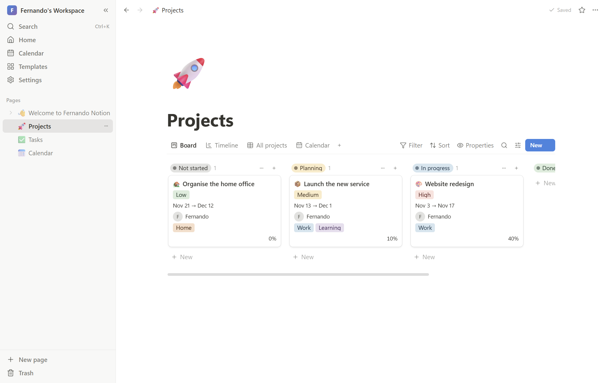
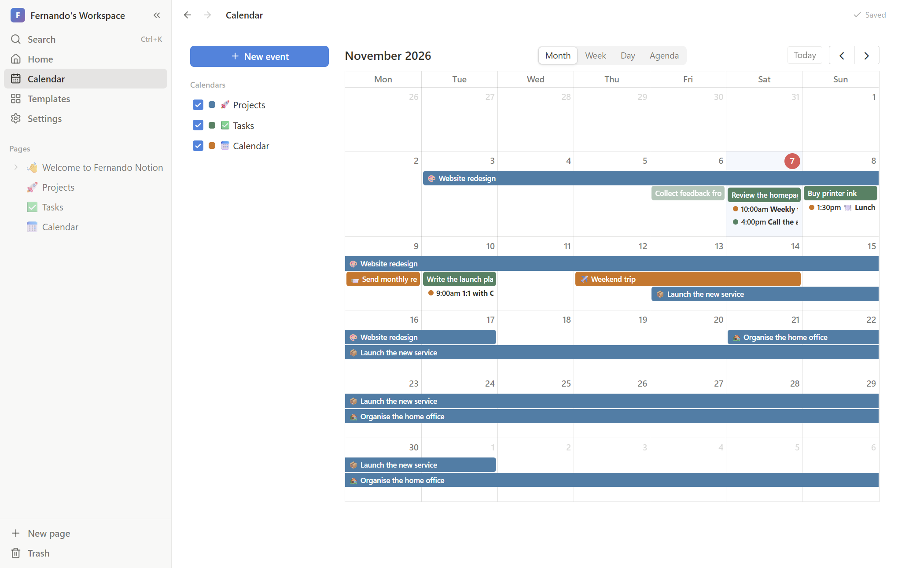

# Fernando Notion

A Notion-style workspace for **notes, projects, calendars and agendas** — as a desktop app.
Everything you write is **saved automatically on your computer**, as you type. No account, no cloud, no save button.



| Pages & block editor | Project board |
| --- | --- |
|  |  |



---

## Download & install (Windows)

1. Go to the **[Releases page](../../releases/latest)**.
2. Download **`Fernando-Notion-Setup-1.0.0.exe`** and run it.
   - Windows may show *“Windows protected your PC”* because the app isn't code-signed.
     Click **More info → Run anyway**.
   - Prefer no installation? Download **`Fernando-Notion-Portable-1.0.0.exe`** instead and just double-click it.
3. Open **Fernando Notion** from the Start menu or the desktop shortcut.

**Mac / Linux:** when available, the `.dmg` (Mac) and `.AppImage` (Linux) files are on the same Releases page.
On a Mac, if it says the app “is damaged” or “can't be opened”, right-click the app → **Open**, or run
`xattr -cr "/Applications/Fernando Notion.app"` in Terminal once. You can always [run it from source](#run-from-source) too.

## Where are my pages saved?

- Every page is saved as a small file inside **`Documents/Fernando Notion/`** — automatically, about half a second after you stop typing, and again when you close the window.
- A **backup of the whole workspace is made every day** in `Documents/Fernando Notion/backups/` (the last 30 are kept). You can restore any of them from **Settings → Your data**.
- Want your pages on several computers? In **Settings → Your data → Change folder…** pick a folder inside **OneDrive, Dropbox or Google Drive**. (Use one computer at a time.)
- **Settings → Export** creates a single `.json` file with everything (images included) that you can keep as an extra backup or import on another computer.
- Updating the app never touches your pages — just install the new version over the old one.

## What it can do

**Pages & writing**
- Nested pages in a sidebar (drag & drop to reorder or nest), favorites, trash with restore
- Block editor: headings, to-do lists, bullet/numbered/toggle lists, quotes, callouts, dividers, code blocks with syntax highlighting, tables, images, video, audio and files
- Type **`/`** for the block menu, **`@`** to mention a page or a date, Markdown shortcuts (`#`, `-`, `[]`, `>`, ```` ``` ````)
- Drag blocks by their ⋮⋮ handle, text colors & highlights, links
- Page icons (emoji), covers (gradients, colors, your own images), full width, small text, serif/mono fonts, lock page
- Comments on pages, word count, export to **Markdown** and **PDF**, import Markdown files

**Databases** (like Notion's)
- Views: **Table, Board (kanban), Calendar, Timeline (Gantt), List, Gallery** — as many views per database as you like
- Properties: text, number, select, multi-select, status, date (with end date and time), checkbox, person, URL, email, phone, relation, created/edited time
- Filters, sorts, show/hide properties, search, drag cards between columns, resize columns
- Every row is a full page; open it in a side panel. Templates for new rows (e.g. meeting notes)
- Inline databases inside any page (`/board view`, `/table view`, `/calendar view`…) and linked views

**Calendars & agendas**
- **Home**: greeting, the next 7 days at a glance, **today's agenda** with overdue tasks, quick “add a task”, recent pages
- **Calendar**: every database with a date shows up in one calendar (month / week / day / agenda), each with its own color; drag events to reschedule, drag edges to change duration, click a day to add an event

**Templates** (one click): Project Tracker, Task List, Calendar & Agenda, Weekly Agenda, Meeting Notes, Daily Journal, Goals, Habit Tracker, Reading List, Quick Notes.

**Everything else**: quick search of all pages and their content (**Ctrl+K**), back/forward navigation, light/dark mode, spell-check.

## Keyboard shortcuts

| Shortcut | Action |
| --- | --- |
| `Ctrl+K` | Search |
| `Ctrl+N` | New page |
| `Ctrl+\` | Show/hide sidebar |
| `Ctrl+Shift+L` | Dark mode |
| `Alt+←` / `Alt+→` | Back / forward |
| `/` | Insert a block |
| `@` | Mention a page or a date |
| `Ctrl+B` / `Ctrl+I` / `Ctrl+U` | Bold / italic / underline |
| `Tab` / `Shift+Tab` | Indent / outdent |
| `Esc` | Close side panel or menu |

(On a Mac use `Cmd` instead of `Ctrl`.)

---

## Run from source

You need **[Node.js](https://nodejs.org) 22 or newer**.

```bash
git clone https://github.com/josemacontrerasp-arch/fernando-notion.git
cd fernando-notion
npm install
npm start
```

## Build the installers yourself

```bash
npm run dist:win     # Windows installer + portable .exe  → release/
npm run dist:mac     # macOS .dmg (run this on a Mac)
npm run dist:linux   # Linux AppImage
```

Publishing a GitHub Release also builds the Windows, macOS and Linux installers automatically
(see `.github/workflows/build.yml`) and attaches them to the release.

## Development

```bash
npm run dev       # Electron + hot reload
npm run dev:web   # just the web UI at http://127.0.0.1:5173 (saves to the browser instead of files)
npm run typecheck
```

Project layout:

```
electron/        main process (window, file storage, backups, PDF export) + preload bridge
src/lib/         data model, store, auto-save, database logic, templates, export
src/components/  sidebar, pages, editor (BlockNote), databases (table/board/calendar/timeline/list/gallery), home, calendar
```

Built with Electron, React, [BlockNote](https://www.blocknotejs.org) (MPL-2.0), [FullCalendar](https://fullcalendar.io) (MIT), Zustand, date-fns and Lucide icons.

---

### En español — instalación rápida

1. Entra en **[Releases](../../releases/latest)** y descarga **`Fernando-Notion-Setup-1.0.0.exe`**.
2. Ábrelo. Si Windows dice *“Windows protegió tu PC”*, pulsa **Más información → Ejecutar de todas formas**.
3. Todo lo que escribes se guarda solo en **Documentos/Fernando Notion** y se hace una copia de seguridad cada día.

---

*Fernando Notion is an independent personal project and is not affiliated with or endorsed by Notion Labs, Inc.*
